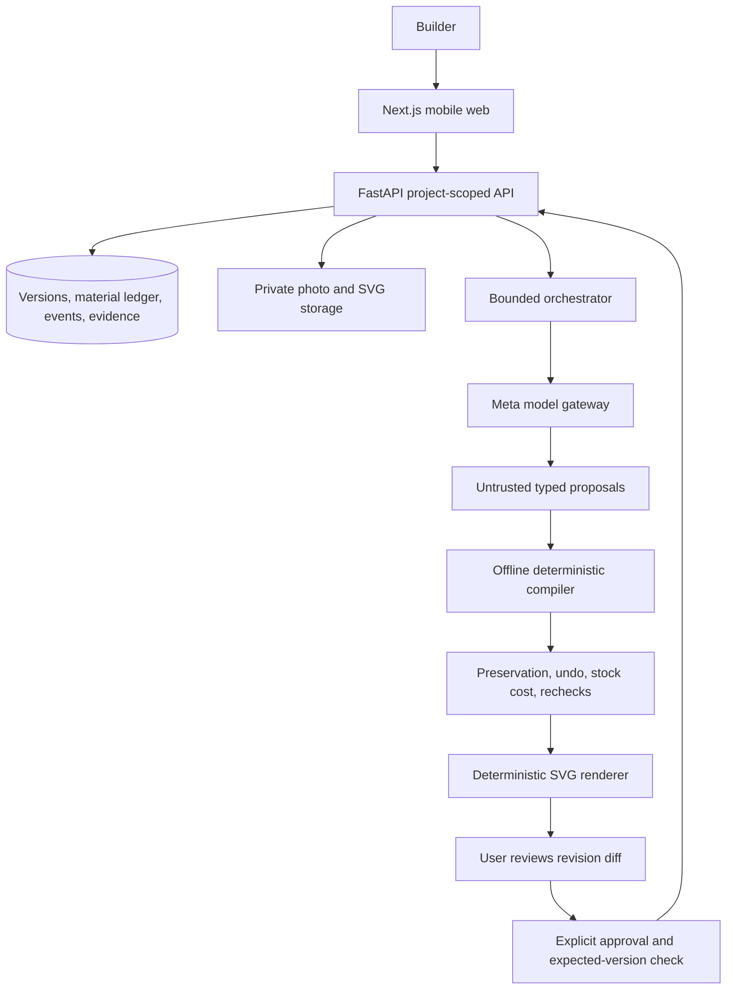

# Architecture

Status: planned boundaries from formspec.md sections 3-13. The workspace
implements a Next.js preview and API liveness route; the flow below is planned.

## Module boundaries

| Module        | May depend on                                           | Must not own                                        |
| ------------- | ------------------------------------------------------- | --------------------------------------------------- |
| domain        | Pydantic and basic value types                          | Provider calls, persistence, UI                     |
| compiler      | domain                                                  | Network, physical success claims, state commits     |
| replanner     | domain, compiler                                        | Provider calls, database writes, automatic approval |
| renderer      | domain and compiled geometry                            | Independent model-created geometry                  |
| API services  | domain, compiler, replanner, renderer, storage adapters | Unvalidated state mutation                          |
| model gateway | Provider client and bounded proposal schemas            | Physical event completion or plan activation        |
| web           | Generated API types and API client                      | Server keys, stock/repair authority                 |
| evaluation    | Offline modules and explicit live/physical adapters     | Fabricated results                                  |

The API package is `forma_api` under `apps/api/src`, installed from the root
Python project. Domain package names and generated contracts remain in #3.
Directory boundaries are conceptual and may be simplified without changing
these rules.

## Three records

1. **Plan:** immutable versioned intended geometry, stock allocations, operations
   and checkpoints.
2. **Execution:** append-only user-confirmed actions, measurements, damage and
   functional tests.
3. **Evidence:** photos, provenance, interpretations, checks and invalidation
   records. Historical evidence remains visible after it becomes stale.

PostgreSQL and private object storage are the production targets in the spec.
SQLite and local assets are allowed for development. Hosting, auth and storage
providers remain [pending decisions](decisions.md).

## Revision transaction

1. Capture the active version, actual events and remaining stock.
2. Obtain at most three typed patch proposals with bounded model/tool rounds.
3. Simulate each patch on a copy; reject schema, stock, geometry, operation and
   tested-profile violations before ranking feasible candidates.
4. Compute compatible preserved work, required physical undo, irreversible loss,
   replacement material and transitive checkpoint invalidation.
5. Render a diff with kept/redo/undo/waste/new-stock/recheck fields.
6. On explicit user approval, validate the expected active version and commit
   the new version, material transactions and invalidations atomically.
7. Return 409 for a stale base. Rejection changes no active state. Retrying an
   idempotent mutation cannot consume material twice.
8. Re-render changed dependency hashes only; render reuse never implies a
   physical checkpoint is still valid.

## Physical and model limits

The first family is a small cardboard/paperboard tabletop stand. Measured stock
and tested joint profiles bound supported geometry. Code checks machine-readable
constraints; a person checks actual joint grip, stability and function.

Spark interprets, diagnoses and proposes. SAM assists object review with manual
box/label fallback. Neither determines exact photo scale, hidden strength or
physical success. Provider details stay in the API gateway. The compiler works
without an API key. See [contracts.md](contracts.md) and
[model-compatibility.md](model-compatibility.md).
