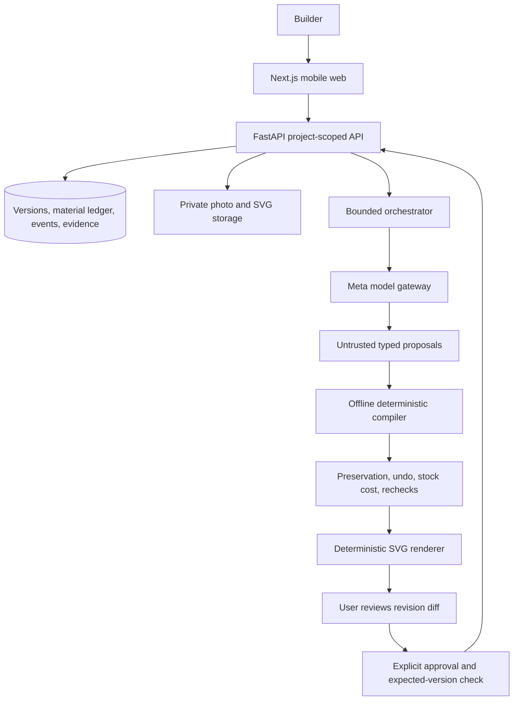

# Architecture

Status: October 31, 2026. The workspace implements typed domain contracts,
offline compiler/stand renderer/replanner, a bounded model gateway and proposal
service, and private project/inventory/photo persistence. The web supports local intake;
the complete user journey below is the target architecture. Live provider
compatibility and physical build/recovery acceptance remain unverified.

## Module boundaries

| Module        | May depend on                                           | Must not own                                        |
| ------------- | ------------------------------------------------------- | --------------------------------------------------- |
| domain        | Pydantic and basic value types                          | Provider calls, persistence, UI                     |
| compiler      | domain                                                  | Network, physical success claims, state commits     |
| replanner     | domain, compiler                                        | Provider calls, database writes, automatic approval |
| renderer      | domain and compiled geometry                            | Independent model-created geometry                  |
| API services  | domain, compiler, replanner, renderer, storage adapters | Unvalidated state mutation                          |
| model gateway | Provider client and bounded proposal schemas            | Physical event completion or plan activation        |
| web           | Generated API types and API client                      | Server keys, stock/repair authority                 |
| evaluation    | Offline modules and explicit live/physical adapters     | Fabricated results                                  |

The root Python project installs `forma_api` under `apps/api/src`, plus
`forma_domain`, `forma_compiler`, `forma_renderer` and `forma_replanner` from
their package source directories. Pydantic remains the domain schema source;
`contracts:generate` exports JSON Schema, OpenAPI components and TypeScript,
and `contracts:check` rejects drift. See the [domain handoff](handoffs/issue-3-domain.md).
Directory boundaries are conceptual and may be simplified without changing
these rules.

## Three records

1. **Plan:** immutable versioned intended geometry, stock allocations, operations
   and checkpoints.
2. **Execution:** append-only user-confirmed actions, measurements, damage and
   functional tests.
3. **Evidence:** photos, provenance, interpretations, checks and invalidation
   records. Historical evidence remains visible after it becomes stale.

These three record types exist in domain contracts. Persistence currently stores
projects, private photos and confirmed pre-plan inventory. It does not yet store immutable
plans, material/physical history, evidence or approved adaptations.

The development API uses SQLite and configured owner bearer credentials.
Project create/read, inventory confirmation and logical deletion are scoped to
the owner. Mutations require idempotency keys; inventory edits compare a separate
inventory revision token and reject stale writes with 409. No route activates a
plan. Inventory image IDs must resolve to the same project's private decoded
photos. Evidence IDs remain rejected. See the
[persistence handoff](handoffs/issue-6-persistence.md) and
[media handoff](handoffs/issue-6-private-media.md).

PostgreSQL and private object storage remain the production targets in the spec.
Hosted identity, production storage/retention and provider-transfer consent remain
[pending decisions](decisions.md).

The local web workbench creates/reopens projects, uploads and links private
photos, and saves measured/unknown stock through the scoped API. A same-origin
rewrite forwards the caller's development credential to a fixed configured API
origin. The credential stays in React memory; no shared server owner credential
is inserted. API-local Pydantic envelopes generate separate browser types while
domain generation remains offline. See the [intake handoff](handoffs/issue-7-intake.md).

## Revision transaction

This is the required end-to-end transaction. Offline simulation supplies preview
data; authenticated event/history storage, revision review and atomic activation
remain integration work in #6/#11/#12.

1. Capture the active version, actual events and remaining stock.
2. Obtain at most three typed patch proposals with bounded model/tool rounds.
3. Simulate each patch on a copy; reject schema, stock, geometry, operation and
   tested-profile violations before ranking feasible candidates.
4. Compute compatible preserved work, required physical undo, irreversible loss,
   replacement material and transitive checkpoint invalidation.
5. Render a diff with kept/redo/undo/waste/new-stock/recheck fields.
6. On explicit user approval, validate the expected active version and commit
   the new version, material transactions and invalidations atomically.
7. Return 409 for a stale base. Rejection changes no active state. Retrying an
   idempotent mutation cannot consume material twice.
8. Re-render changed dependency hashes only; render reuse never implies a
   physical checkpoint is still valid.

## Physical and model limits

The first family is a small cardboard/paperboard tabletop stand. Measured stock
and tested joint profiles bound supported geometry. Code checks machine-readable
constraints; a person checks actual joint grip, stability and function.

Spark interprets, diagnoses and proposes. SAM assists object review with manual
box/label fallback. Neither determines exact photo scale, hidden strength or
physical success. Provider details stay in the API gateway. The compiler works
without an API key. See [contracts.md](contracts.md) and
[model-compatibility.md](model-compatibility.md).

## Implemented services and remaining boundaries

- `forma_compiler.validate_plan` replays stock regions, parts, connectors and
  operations, checking allocation, dependencies, measured process limits and
  compatible profiles. Unused unknown inventory is retained without allocation;
  material used by the plan still requires its critical measurements. Inputs
  remain immutable. See the [compiler handoff](handoffs/issue-5-compiler.md).
- `forma_renderer.compile_stand` builds one three-panel triangular stand with a
  folded lip and tape hinges. `render_manual` independently validates supported
  geometry and emits eight deterministic SVG panels and a BOM, including tape
  balances and explicit offcut regions when present in the plan. Unallocated
  sheet area remains waste. Panel hashes permit reuse of unchanged diagrams.
  Synthetic fixtures require explicit opt-in and visible labels; default calls
  require measured stock/process and reviewed profile evidence. See the
  [renderer handoff](handoffs/issue-8-stand-manual.md).
- `forma_replanner.simulate_patch` validates copied snapshots and history,
  reconciles actual remaining stock, and returns preservation, loss, rechecks
  and continuation blockers. `rank_feasible` ranks at most three feasible
  reports using known cost terms; time, prices and waste estimates remain
  unknown. Completed modifications requiring undo block until an explicit
  continuation exists. Joint-strategy/stand-angle changes require family
  regeneration and currently block; known stand plans require an injected
  family continuation validator. No simulation commits state. See the
  [replanner interface](../packages/replanner/README.md).
- The server-only Meta gateway validates structured outputs and allowlisted
  read-only tools, bounds calls, and records safe traces. SAM/manual boxes use
  media pixels and establish no physical dimensions. The smoke script separates
  Spark validation from SAM failure and makes no request without explicit live
  prerequisites. Real account/photo results remain pending in
  [model compatibility](model-compatibility.md).
- `ProposalService.run` supports intake, design, diagnosis and repair against a
  validated scoped snapshot. Candidate and round caps span retries; injected
  deterministic validators gate usable designs/repairs. Diagnosis can reference
  current-plan features without expanding repair targets. Authenticated HTTP
  exposure, trusted catalogue loading and compiler/replanner callback wiring
  remain consumer work. See the [proposal handoff](handoffs/issue-9-bounded-proposals.md).

The API currently mounts health and project/inventory routes. Uploads, model and
manual endpoints, chronological event recording, revision activation and proof
history are not connected to the web preview. Offline module acceptance never
records a physical test pass.
